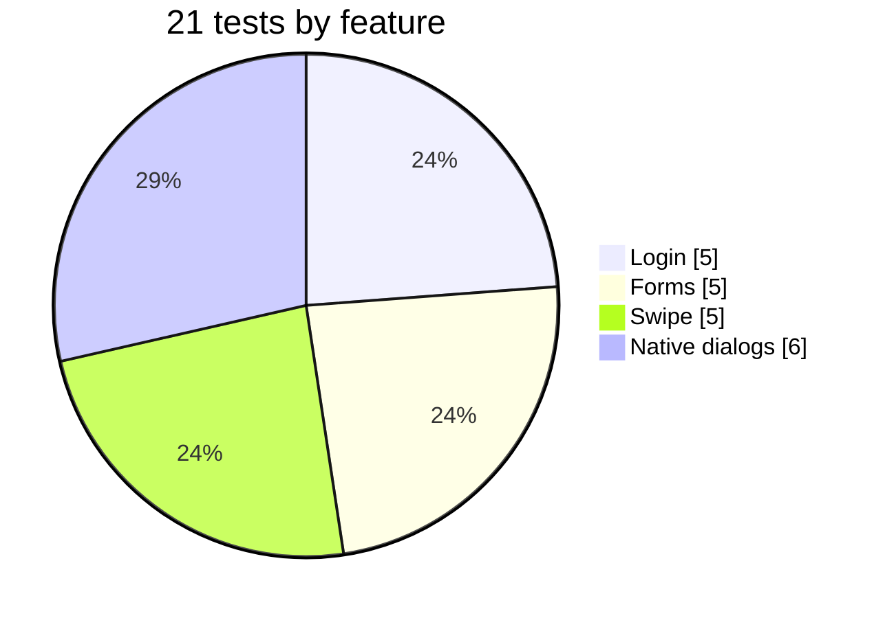
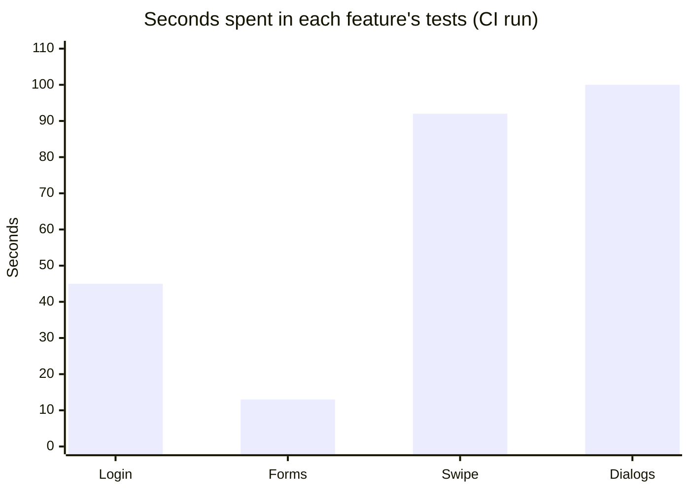
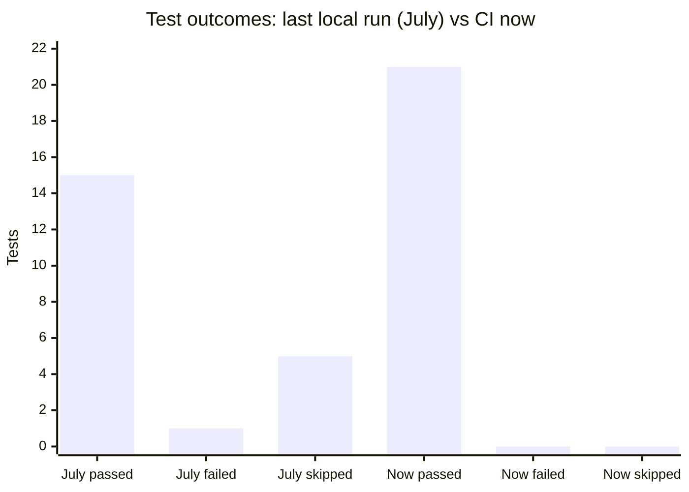
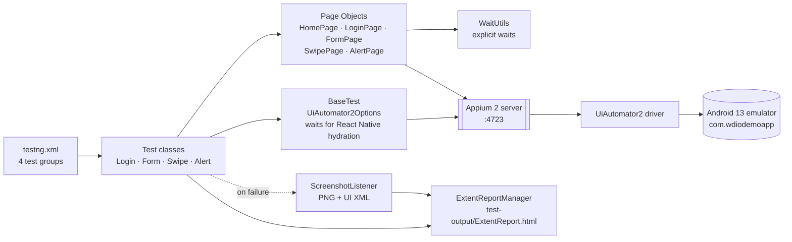
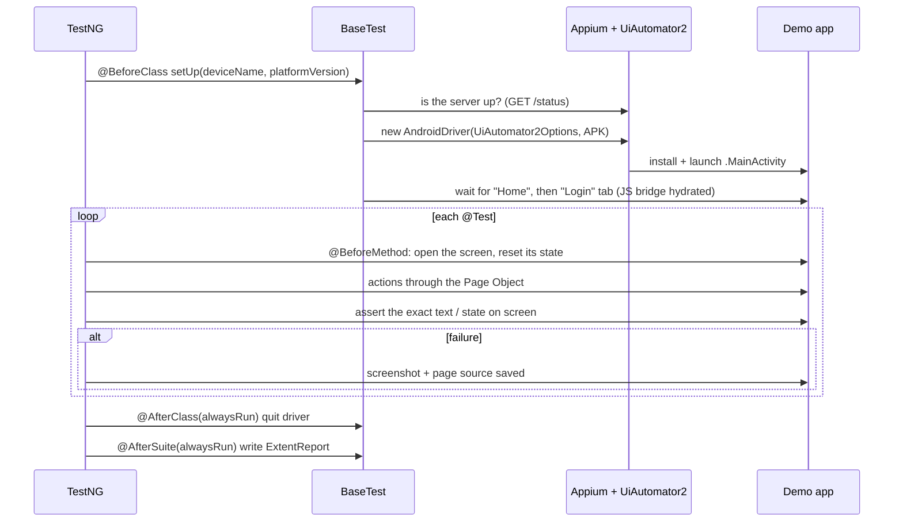
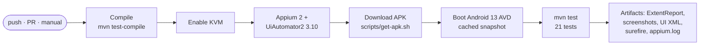
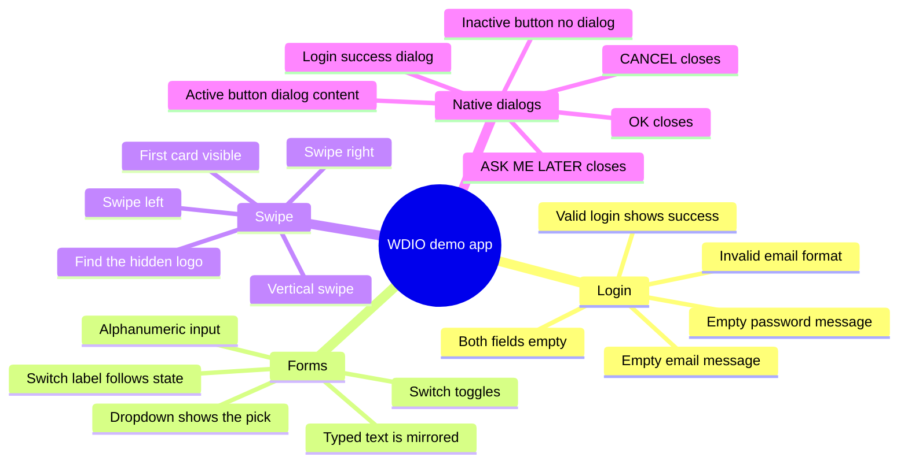
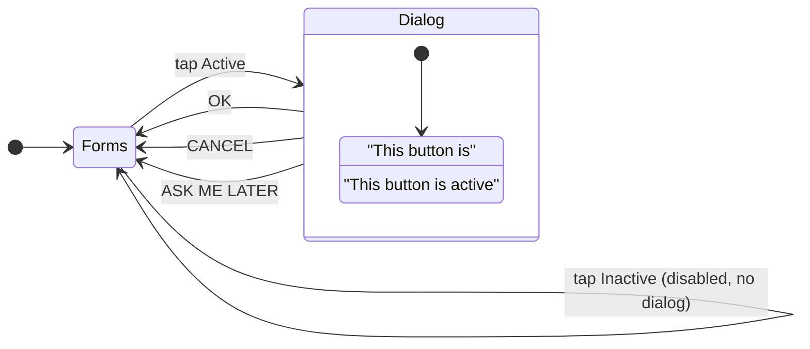
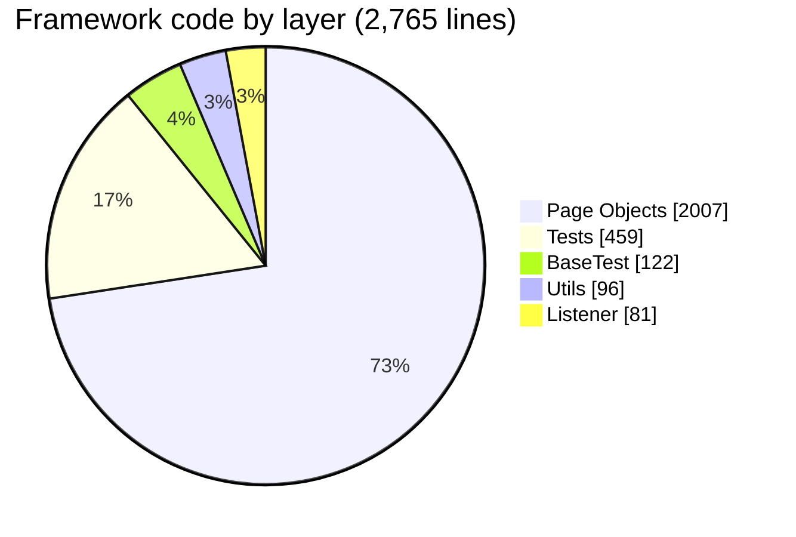

<div align="center">

# 📱 WDIO Native Demo App — Mobile Test Automation (Java · Appium · TestNG)

### Android UI tests for WebdriverIO's official React Native demo app: Page Objects, Appium 2 + UiAutomator2, ExtentReports, and a real Android 13 emulator in GitHub Actions

[](https://git.io/typing-svg)

<!-- ============ STATUS BAR ============ -->
[](https://github.com/rbchy/WebdriverIO-Native-DemoApp-MobileTestAutomationJavaAppiumTestNG/actions/workflows/ci.yml)


</div>

---

## 📌 At a Glance

<table>
<tr>
<td width="50%" valign="top">

**🙋 What this is**

A Page Object framework that tests the Android build of the **[WDIO Native Demo App v2.2.0](https://github.com/webdriverio/native-demo-app)**, the React Native app the WebdriverIO team publishes for test automation practice. It covers:

- login validation, success and error messages
- form widgets: text mirror, switch and its label, dropdown
- swipe gestures on the card carousel
- the app's **native Android dialogs**

The whole suite runs **on every push**. GitHub Actions boots an **Android 13 emulator** (KVM), starts **Appium 2 + UiAutomator2**, installs the APK and runs all 21 tests. The ExtentReport, failure screenshots, UI-hierarchy dumps and the Appium log are uploaded as artifacts.

</td>
<td width="50%" valign="top">

**📍 Quick facts**

| | |
|---|---|
| 🤖 **App** | WDIO Native Demo App 2.2.0 (React Native) |
| 📱 **Device** | Android 13 emulator (API 33, x86_64) |
| 🧪 **Tests** | 21: Login 5 · Forms 5 · Swipe 5 · Dialogs 6 |
| ✅ **CI** | 21 / 21 · suite ≈ 7.5 min |
| 🧱 **Pattern** | Page Object Model, one driver per class |
| 📊 **Reports** | ExtentReports · screenshot + UI XML on failure |
| 🔁 **Runs** | push · pull request · manual |

</td>
</tr>
</table>

---

## ✅ Latest Results (GitHub Actions, Android 13 emulator)

| Feature | Tests | Result | Time in tests |
|---|:--:|:--:|--:|
| 🔐 Login | 5 | ✅ 5 / 5 | 45 s |
| 📝 Forms | 5 | ✅ 5 / 5 | 13 s |
| 👆 Swipe | 5 | ✅ 5 / 5 | 92 s |
| 🔔 Native dialogs | 6 | ✅ 6 / 6 | 100 s |
| **Total** | **21** | **✅ 21 / 21** | **≈ 7.5 min with app start-up** |





> Two tests take most of the time: *swipe to the hidden logo* (~86 s) and *login success dialog* (~81 s). Both go through long fallback searches written for a slower local emulator. Tightening them is on the roadmap.

### Before → after this update



| | Last local run (July) | Now, in CI |
|---|:--:|:--:|
| Passed | 15 | **21** |
| Failed | 1 (TC-L03) | **0** |
| Skipped | 5 (every alert test) | **0** |
| Tests that could pass without checking anything | 5 (see Maintenance Log) | **0** |

---

## 🏗️ Architecture



### 🔄 What happens in one test class



### 🚦 CI pipeline



---

## 🧪 Test Cases



### 🔐 Login

| ID | Test case | Asserts |
|---|---|---|
| TC-L01 | Valid credentials | "You are logged in!" appears, no email error shown; the dialog is closed afterwards |
| TC-L02 | Empty email | Shows *"Please enter a valid email address"*, and no password error |
| TC-L03 | Empty password | Shows *"Please enter at least 8 characters"*, and no email error |
| TC-L04 | Invalid email format | Shows *"Please enter a valid email address"* |
| TC-L05 | Both fields empty | Shows both messages |

### 📝 Forms

| ID | Test case | Asserts |
|---|---|---|
| TC-F01 | Text input | The *input-text-result* mirror equals the typed text **exactly** |
| TC-F02 | Switch | `checked` flips, and flips back on a second tap |
| TC-F03 | Dropdown | The field shows *"Appium is awesome"*, then *"This app is awesome"* after a second pick |
| TC-F04 | Switch label | *"Click to turn the switch ON/OFF"* follows the state |
| TC-F05 | Alphanumeric input | The mirror equals `Test123` |

### 👆 Swipe

| ID | Test case | Asserts |
|---|---|---|
| TC-S01 | First card | *FULLY OPEN SOURCE* is visible |
| TC-S02 | Swipe left | *GREAT COMMUNITY* is visible |
| TC-S03 | Swipe right | Back to the first card |
| TC-S04 | Hidden logo | Scrolls to *find-me*, taps it, and the "You found me" confirmation appears |
| TC-S05 | Vertical swipe | The gesture completes and the screen is still shown (smoke only) |

### 🔔 Native dialogs

The old tests looked for Alert / Confirm / Prompt buttons. Those belong to a different demo app (ApiDemos), so the tests could never run. They were replaced with the dialogs this app really has.



| ID | Test case | Asserts |
|---|---|---|
| TC-A01 | Active button | Title *"This button is"*, message *"This button is active"*, buttons OK / CANCEL / ASK ME LATER |
| TC-A02 | OK | The dialog closes |
| TC-A03 | CANCEL | The dialog closes |
| TC-A04 | ASK ME LATER | The dialog closes |
| TC-A05 | Inactive button | No dialog appears |
| TC-A06 | Login success | Title *"Success"*, message *"You are logged in!"*, and OK closes it |

---

## ▶️ Running Locally

**You need:** JDK 17, Maven 3.6+, Node 18+ with Appium 2, and the Android SDK with an emulator or a device.

```bash
# 1. Appium 2 + a driver line that supports it
npm install -g appium@2
appium driver install uiautomator2@3.10.0

# 2. The app under test (downloaded next to pom.xml; not committed)
./scripts/get-apk.sh

# 3. Start an emulator (API 33 recommended) and Appium
emulator -avd <your_avd> &
appium &

# 4. Run
mvn clean test
open test-output/ExtentReport.html      # report; failures in test-output/screenshots/
```

The device is set in `testng.xml` (`deviceName = emulator-5554`, `platformVersion = 13`). Change both to match your device.

---

## 📁 Project Structure

```text
WebdriverIO-Native-DemoApp-MobileTestAutomationJavaAppiumTestNG/
├── .github/workflows/ci.yml          # compile → Android 13 emulator + Appium → 21 tests → artifacts
├── scripts/get-apk.sh                # downloads android.wdio.native.app.v2.2.0.apk
├── src/main/java/
│   ├── base/BaseTest.java            # driver per class, hydration wait, alwaysRun teardown
│   ├── pages/                        # HomePage · LoginPage · FormPage · SwipePage · AlertPage
│   ├── tests/                        # LoginTest · FormTest · SwipeTest · AlertTest
│   ├── listeners/ScreenshotListener  # PNG + UI XML on failure, ExtentReports logging
│   └── utils/                        # WaitUtils · ExtentReportManager
├── testng.xml
└── pom.xml
```



---

## 🧹 Maintenance Log

The README was checked against the code, and the suite was run on a real emulator in CI. These issues were found and fixed:

| Issue found | Fix |
|---|---|
| ❌ **No CI**, and the suite had never run anywhere but one laptop | Added GitHub Actions with an Android 13 emulator, Appium 2 and UiAutomator2, plus artifacts |
| 🔁 **All 5 alert tests could only be skipped.** They searched for Alert / Confirm / Prompt buttons from ApiDemos, which this app does not have. | Replaced with 6 tests of the app's real native dialogs |
| 🎯 **Wrong locators, hidden by fallbacks.** The app uses `input-text-result` (code had `text-input-result`) and `button-LOGIN` (code had `login-btn`). TC-F01 / F05 passed only because they read the text back from the input itself, and every login tap went through slow fallbacks. | Fixed the locators. Tests now compare the mirror text exactly. |
| 🙈 **Negative login tests could not fail.** "Error shown" meant the page source contained `error` or `Invalid`. The password message ("Please enter at least 8 characters") was not recognised at all, which is why TC-L03 failed. | Each test asserts the exact validation message it expects, and that the other message is absent |
| 🧹 **Tests leaked state into each other.** The login fields kept the previous test's text, so *empty email* actually submitted an email and logged in. | Each login test starts with empty fields |
| 🔽 **Two checks were vacuous.** *Dropdown* passed if anything on the page changed, and *Slider* passed by only checking that the Forms screen was open (v2.2.0 has no slider). | The dropdown value is now asserted. The slider test was replaced by the switch-label test. |
| 📊 **The ExtentReport was lost** whenever a class's set-up was skipped, because `@AfterSuite` was skipped too. A second failure of a test also lost its screenshot (the file already existed). | `alwaysRun = true`, screenshots overwrite, and the UI hierarchy XML is saved next to each screenshot |
| 📝 **The README claimed features that are not in the code:** Allure, `AllureScreenshotListener`, `rerunFailingTestsCount = 4`, an APK in the repo, "100 % pass" | Rewritten to match the code and the CI results |
| 📦 `target/` and old failure screenshots were committed | Removed, and added a `.gitignore` |

---

## 📈 Roadmap

- [ ] Cut the two slow paths (hidden-logo scroll, login after navigation) from ~80 s to a few seconds
- [ ] Make TC-S05 assert what the vertical swipe reveals
- [ ] Allure reporting next to ExtentReports
- [ ] Drag-and-drop puzzle, WebView and biometrics screens
- [ ] Parallel runs on two emulators (API 30 and 34) with a TestNG data provider
- [ ] iOS run on a macOS runner with XCUITest

---

## 🔗 Related Projects

| Project | Stack |
|---|---|
| 📱 [Appium Automation – API Demos](https://github.com/rbchy/AppiumAutomation_ApiDemos) | Appium · Android · CI |
| 🏔️ [NorthFace × Automation Exercise BDD](https://github.com/rbchy/NorthFace_AutomationExercise-BDD-Test-Automation) | Selenium · Cucumber · RestAssured · CI |
| 🎭 [QaBrains Automation – Playwright TypeScript](https://github.com/rbchy/QaBrainsAutomationTypeScriptPlaywright) | Playwright · TypeScript · CI |
| 🌲 [QaBrains Automation – Cypress](https://github.com/rbchy/QaBrainsAutomationCypressJavaScript) | Cypress · JavaScript · CI |

<sub>All projects: [github.com/rbchy](https://github.com/rbchy)</sub>

---

## ⚠️ Disclaimer

This is a portfolio / training project. The WDIO Native Demo App belongs to the [WebdriverIO](https://webdriver.io/) project. It is downloaded from their releases at test time and is not redistributed here.

---

## 👤 Author

<div align="center">

**Ranajit Baran Chowdhury (RB Chowdhury)**
QA Automation Engineer / SDET · West Norriton, Pennsylvania, USA

[](https://www.linkedin.com/in/rbchy/)
[](https://github.com/rbchy)
[](https://rbchy.github.io/rbchy/)
[](https://rbc6543.wixsite.com/rbc-portfolio)
[](mailto:chyranajit@gmail.com)

<sub>MIT licensed — see [LICENSE](LICENSE).</sub>

⭐ *If this project helps you, a star on the repo is appreciated.*

</div>
